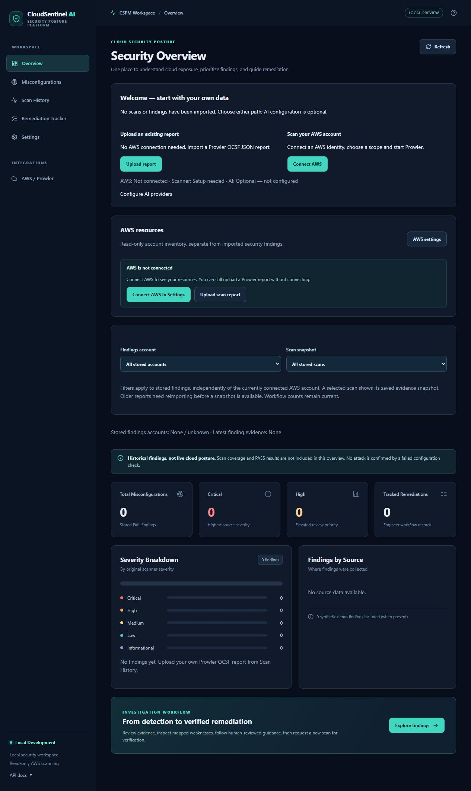
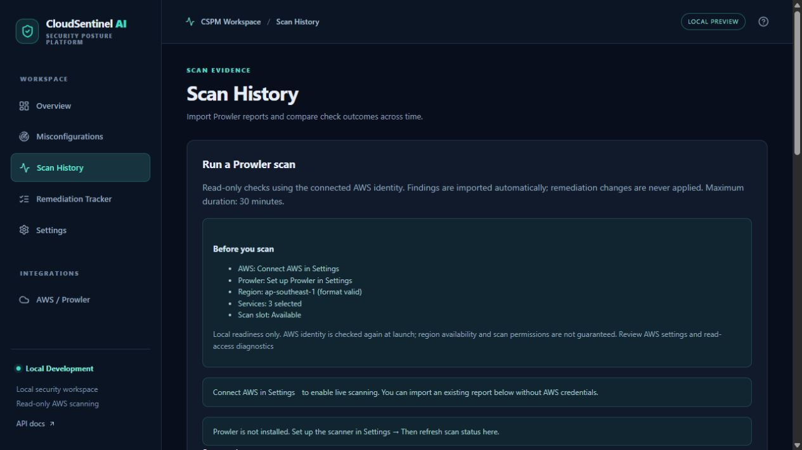
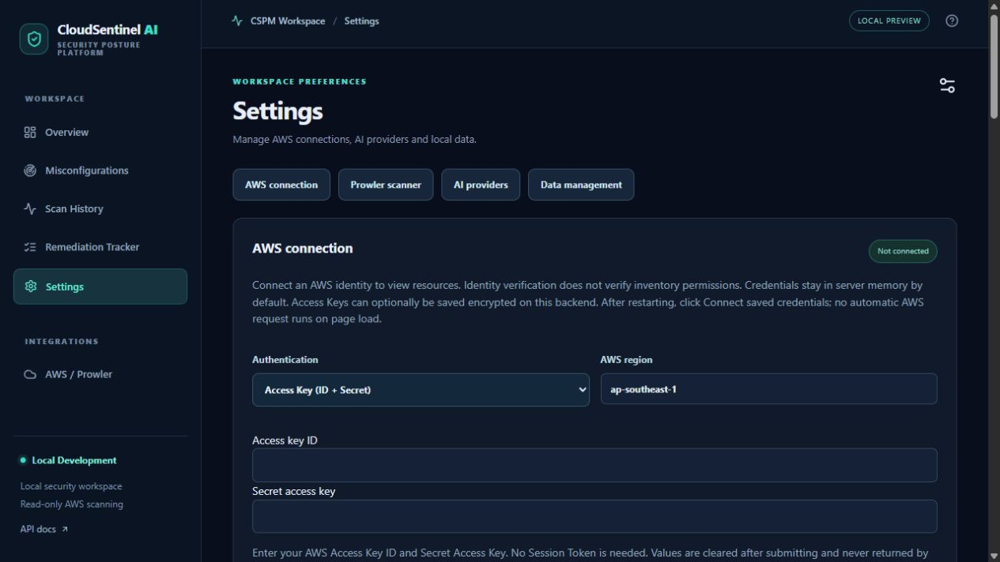

# CloudSentinel AI

Local AWS security posture workspace with optional AI-assisted remediation guidance.

**Preview release — Linux/WSL, single operator, localhost only.** No login/RBAC or multi-user isolation. Do not expose the UI or API publicly. Real AWS scan and AI provider end-to-end acceptance remain outstanding; offline tests are not a substitute.

## Project origins

CloudSentinel AI originated as a personal academic final-year project (FYP). This repository builds on that prototype and is now developed independently, with continued improvements to usability, security controls, installation, and maintainability. It is no longer maintained solely as an academic submission.

## Run locally

Install Python 3.12 and Node.js 22, then run `bash scripts/setup-linux.sh` inside Linux/WSL. Start with `bash scripts/start-linux.sh` (Linux) or **Start CloudSentinel.cmd** (Windows). Use the matching stop script to stop only CloudSentinel.

Settings includes workspace backup/restore; credentials are excluded. API recovery guidance appears only when the local API is unavailable. AWS connection details are available in Settings.

## Start here

- [Installation and first use](docs/getting-started.md)
- [Scanning, snapshots and verification](docs/web-scanning.md)
- [AI settings](docs/ai-settings.md)
- [Security policy](SECURITY.md)
- [Contributing](CONTRIBUTING.md)

The application starts empty. Import your own Prowler OCSF JSON, or connect AWS in Settings and explicitly authorize a scan. No credentials or AI subscription are needed to browse the empty workspace. Synthetic fixtures in `mock_data/scan_history` are optional and must be imported as synthetic data.

## Implemented

- AWS connection settings, read-only resource inventory and diagnostics.
- Prowler setup in a separate Linux environment; service/region selection, cancellation and persisted job history.
- OCSF import, finding filters, immutable snapshots for new imports and report comparison.
- Remediation tracking and explicit rechecks; only matching fresh PASS evidence can verify a case.
- Optional AI providers with backend credentials, prompt preview, best-effort redaction and explicit consent.
- Local finding/history deletion and actionable scan failure guidance.

No remediation commands are executed automatically. A failed check is not evidence of an attack; a PASS is not proof of complete account security. Prowler errors with only an exit code cannot be reliably attributed to a specific AWS cause.

## Version history

The entries below summarize recorded development milestones. Versions before the first public preview were local development versions, not published GitHub releases. Their features describe what changed at the time; current setup instructions and limitations take precedence.

| Version | Main changes |
| --- | --- |
| v0.9.2 — local development | Added standalone/startup installation diagnostics, guided AWS connection with optional declared session expiry, operation-specific read-access errors, and report preview with explicit confirmation, duplicate notices and event-level errors. Live AWS acceptance is deferred. |
| [v0.9.1-preview.1](https://github.com/xixsui/cloudsentinel-ai/releases/tag/v0.9.1-preview.1) | Windows/WSL and Linux start/stop launchers; managed processes and duplicate-start protection; pinned Python 3.12/npm installation; validated workspace backup and restore with a recovery copy; API failure recovery guidance; a compact Overview hint that hides after connecting AWS or importing reports; hidden disconnected inventory and empty filters. |
| [v0.9.0-preview.1](https://github.com/xixsui/cloudsentinel-ai/releases/tag/v0.9.0-preview.1) | First public release. Consolidated the local prototype with report import fixes, scan history/comparison and immutable evidence snapshots, dedicated AI/AWS Settings, backend credential storage, resource inventory, Prowler setup and scoped scan jobs, finding deletion, and explicit remediation rechecks. Added English installation documentation and downloadable source/checksum assets. |
| v0.9.0 — local prototype | Separated scan evidence, unverified conditions, and AI hypotheses; added deterministic recommendation-review alerts, per-step copy actions, saved-run feedback, and prompt-version tracking. Review alerts do not certify command safety. |
| v0.8 | Added selection among configured AI providers/models and an optional OpenAI-compatible private inference endpoint, with server-side credentials, destination controls, and provider/model-specific caching. |
| v0.7.2 | Improved Groq structured responses with strict JSON schemas and completion budgets; handled truncated or invalid output without saving it as successful analysis; added persistence and provider-error regression coverage. |
| v0.7 | Added an opt-in AI Remediation Advisor to the Next.js interface, explicit external-processing consent, bounded/redacted input, validated response history, caching, and regeneration. |
| v0.6.0 | Introduced the Next.js interface and FastAPI facade for Overview, findings, finding details, and remediation tracking, while preserving the existing SQLite data and legacy Streamlit interface. Added local write-token protection. |
| v0.5.0 | Added human-reviewed remediation workflows, conservative CWE/ATT&CK potential mappings, offline baseline guidance, remediation audit records, and PASS/FAIL evidence tracking for verification. |
| v0.4.0 | Added an offline-capable incident investigation workbench with filters, assignments, chronology, activity notes, case export, and explainable evidence-based risk factors. |
| v0.3.1 | Refined Streamlit chart layouts and dark styling, reduced full-page reruns for finding analysis, disabled unavailable AI actions, and preserved demo-scan status. |
| v0.3.0 | Added guided cloud connections, verified AWS identity/session handling, scoped Prowler jobs, offline OCSF FAIL import, synthetic scans, and a dark Streamlit interface. |
| v0.2.0 | Reworked credential handling toward environment variables/OS keyring, enabled Wazuh HTTPS verification, tightened scanner output handling, bounded correlation, preserved analyst-assigned status, and expanded documentation/CI. |
| Academic prototype | Original FYP foundation, subsequently developed into the local milestones above. No separate release number is assigned here without a supporting record. |

Early history was reconstructed from the retained local changelog, migration/provider documentation, and version-specific regression tests. Separate v0.7.1 release notes were not available, so no patch-level changes are attributed to that version. Older milestones can include legacy interfaces or optional integrations that differ from the current web workflow.

For downloadable public versions and full release notes, see [GitHub Releases](https://github.com/xixsui/cloudsentinel-ai/releases).

## Interface

Screenshots show an empty, disconnected workspace. No real AWS accounts, credentials or scan reports are displayed.

### Overview and first use



<details>
<summary>Scan readiness and settings</summary>





</details>

## Development

```bash
python -m pip install pytest httpx
python -m pytest -q
cd apps/web
npm run build
```
